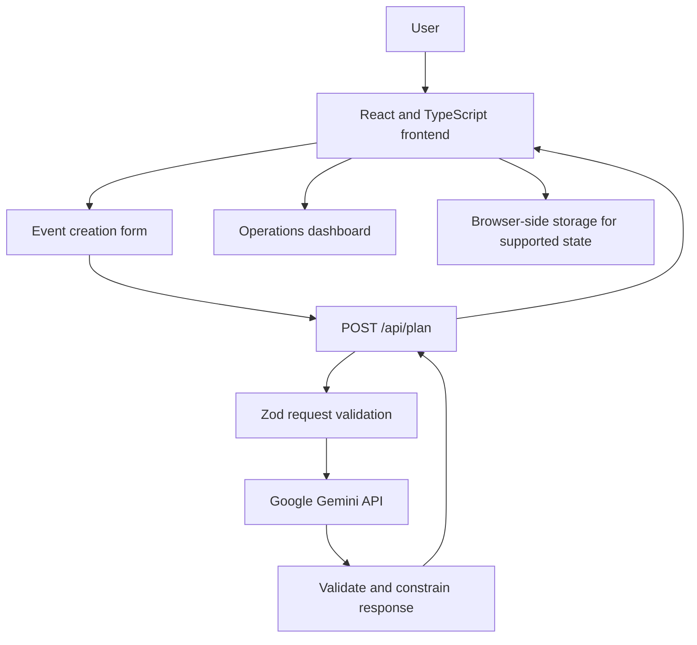

# AuraPlan Architecture

## Purpose

This document describes the current high-level architecture of AuraPlan, an AI-assisted event-planning web application. It complements the [Architecture Decision Records](adr/README.md) and the repository's [README](../README.md).

## System context

AuraPlan provides a browser-based interface for entering event details and reviewing planning recommendations. AI recommendations are generated through an application-owned serverless API endpoint.

## Main components

### Frontend

The frontend is built with React, TypeScript, Vite, Tailwind CSS v4, and React Router. It provides event creation and an operations view for reviewing planning information.

### API client

The shared frontend API module sends event requirements, budget, and date to `/api/plan`, handles request failures, and checks the returned payload before passing data to the UI.

### Serverless API

`api/plan.ts` implements the Vercel serverless endpoint. It validates incoming data, uses the server-side `GEMINI_API_KEY` to call Google's Gemini service, applies constraints to generated planning data, and returns a response.

### Browser-side storage

Supported planning state can be persisted in browser storage. This is not a remote database, backup service, or cross-device synchronization mechanism. Users may lose local data if browser storage is cleared.

### Testing

Vitest is used for automated tests. The exact test coverage and passing count should be taken from the current test run, not inferred from the presence of a test framework.

## Typical request sequence

1. The user enters the event type, date, location, guest count and total budget. The form validates them with `validateEventInput`.
2. The API client sends the request to `/api/plan`.
3. The serverless handler checks the method, content type and size, applies a rate limit, and validates the body with zod.
4. The handler builds a prompt in which user text appears only as JSON inside tagged data blocks, and calls Gemini with a server-side credential, a timeout and one retry on transient errors.
5. The model output is validated. The server converts budget weights into amounts that sum exactly to the available budget, flags overdue tasks as urgent, and validates the final response.
6. The frontend builds the plan (dated timeline, vendor checklist with book-by dates, budget lines, ideas), saves it in browser storage and opens the operations dashboard.
7. On the dashboard the user edits tasks, expenses and vendors locally, can export or print the plan, and can ask for changes in plain words. A refinement repeats steps 2 to 5 with the current plan sent as tagged data, and the result replaces the generated content while keeping completed tasks and booked vendors.

## Data and trust boundaries

- **Browser to API:** treat all incoming request data as untrusted.
- **API to Gemini:** send only the information needed to generate the requested recommendations; users should be informed that AI processing can involve an external provider.
- **Gemini to API:** treat generated output as untrusted until validated.
- **Browser storage:** assume locally stored data can be read or modified by the browser user and potentially by scripts running in the same origin.
- **Environment variables:** keep provider credentials server-side and out of the frontend bundle.

## Deployment

The application is designed for Vercel deployment. The serverless API requires `GEMINI_API_KEY` to be configured in the appropriate Vercel environment. Local development uses the Vercel CLI so the frontend and `/api/plan` endpoint can be tested together.

## Architectural constraints

- AI output can be inaccurate even when its structure is valid.
- Serverless instances do not provide reliable shared in-memory state across all requests.
- Browser storage does not provide cross-device synchronization or durable backup.
- Budget constraints improve consistency but do not guarantee real-world vendor pricing.
- API availability depends on the deployment platform, network, and AI provider.

## Related decisions

- [ADR 0001: Frontend Technology Stack](adr/0001-frontend-stack.md)
- [ADR 0002: Browser-Side Persistence](adr/0002-client-side-persistence.md)
- [ADR 0003: Serverless AI Recommendation Pipeline](adr/0003-serverless-ai-pipeline.md)
- [ADR 0004: Budget Constraints and Expense Validation](adr/0004-budget-constraints-and-validation.md)
- [ADR 0005: API Boundary Validation](adr/0005-api-schema-validation.md)
- [ADR 0006: Event Planning Workflow and State Management](adr/0006-event-planning-state-management.md)
- [ADR 0007: Inline the Shared Schema in the Serverless Function](adr/0007-inlined-api-schema.md)
- [ADR 0008: The Model Decides, Code Calculates](adr/0008-model-judgment-code-arithmetic.md)
- [ADR 0009: Share the Schema Module Between Browser and API](adr/0009-shared-schema-module.md)
